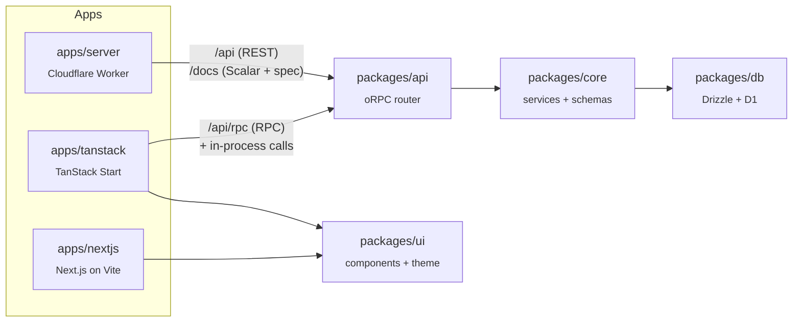

<div align="center">

# Cloudflare Monorepo

**A Bun + Turborepo boilerplate for Cloudflare Workers.**
Three deployable apps, one shared service layer, and a worked example that touches every layer.

[](https://bun.sh)
[](https://nodejs.org)
[](https://turborepo.dev)
[](https://www.typescriptlang.org)
[](https://developers.cloudflare.com/workers/)

[Workspaces](#workspaces) •
[Architecture](#architecture) •
[Quick start](#quick-start) •
[Notes example](#the-notes-example) •
[Commands](#commands) •
[Deploy](#deploying) •
[Troubleshooting](#troubleshooting)

</div>

---

## Why this exists

Setting up a Workers monorepo means wiring the same things every time: shared TypeScript configs, linting, formatting, a test runner that works inside the Workers runtime, D1 migrations, and a clean way to share code between apps. This repo has all of that done, so you can start building.

- **Opinionated wiring, not opinionated frameworks.** The tooling is stable. The notes example is here to be deleted.
- **One service layer, three ways in.** The same oRPC router serves REST, RPC, and in-process calls, so behavior never drifts between them.
- **Zero-build packages.** Packages ship TypeScript source. There is no `dist`, no watch mode for libraries, and no stale builds.
- **One dialect everywhere.** Shared tsconfig, ESLint, Prettier and Vitest packages keep every workspace consistent.
- **Cloudflare-native.** Local dev runs in miniflare, with D1, Wrangler types and the Workers test pool all set up.

## Tech stack

| Area                 | Tools                                                                       |
| -------------------- | --------------------------------------------------------------------------- |
| Runtime and platform | Cloudflare Workers, D1, Wrangler                                            |
| Monorepo             | Bun workspaces (with a shared version catalog), Turborepo                   |
| API                  | oRPC (REST via OpenAPI adapter, plus native RPC), Zod                       |
| Database             | Drizzle ORM on D1                                                           |
| Frontend             | TanStack Start (React SSR), vinext (Next.js on Vite), Tailwind 4, shadcn/ui |
| Quality              | TypeScript, ESLint, Prettier, Vitest (Workers runtime)                      |

## Workspaces

| Workspace                        | What it is                                                                                                                                                   |
| -------------------------------- | ------------------------------------------------------------------------------------------------------------------------------------------------------------ |
| [`apps/server`](apps/server)     | Cloudflare Worker. Mounts `packages/api` at `/api`, serving the Scalar reference at `/docs`, with Wrangler config and Vitest running in the Workers runtime. |
| [`apps/tanstack`](apps/tanstack) | TanStack Start app. React SSR, file-based routing, Tailwind 4, deployed through the Cloudflare Vite plugin.                                                  |
| [`apps/nextjs`](apps/nextjs)     | vinext (Next.js on Vite) app. React Server Components, the shared Tailwind theme and D1, with the oRPC router mounted at `/api/rpc`.                         |
| [`packages/api`](packages/api)   | oRPC router, both fetch handlers (`/server`) and the browser client (`/client`).                                                                             |
| [`packages/core`](packages/core) | Transport-agnostic logic: the notes service, Zod schemas and shared helpers.                                                                                 |
| [`packages/db`](packages/db)     | Drizzle on D1. Typed client and schema, plus migration generation.                                                                                           |
| [`packages/ui`](packages/ui)     | React components and the shared Tailwind theme. React is a peer dependency.                                                                                  |
| [`tooling/*`](tooling)           | Shared tsconfig, ESLint, Prettier and Vitest configs, published internally as `@acme/*`.                                                                     |

> [!NOTE]
> Only three apps ship today. Adding another is a copy-and-rename job, see [Adding a workspace](#adding-a-workspace).

## Architecture



Every request path ends at the same core service, so changing the service changes all of them together. `packages/core` is transport-agnostic: no HTTP, no runtime bindings, no framework. Apps call in; it never calls back out. `apps/nextjs` calls in too: its server actions use `createRpcServer`, and the browser reaches the same procedures at `/api/rpc`.

## Quick start

### Requirements

- **[Bun](https://bun.sh) 1.4.2.** This is the only supported package manager.
- **Node 22.18 or newer** (or Bun itself) to run the tests. Each `vitest.config.ts` imports `@acme/vitest` as TypeScript source, and Node needs type-stripping support to load it.
- **A Cloudflare account**, only when you deploy. Local dev runs in miniflare.

### Install and run

```bash
git clone https://github.com/heyleydotdev/cf-monorepo && cd cf-monorepo
cp .env.example .env      # nothing here is required to boot
bun install
bun run dev               # server on :3001, tanstack on :3000, nextjs on :3002
```

> [!NOTE]
> Packages are consumed as TypeScript source, so `dev` needs no build step and each package is read directly from `src`.

### Apply the local database schema

The notes pages read and write D1 through the service layer, so apply the schema to each app you run:

```bash
bun run migrate
```

That runs `migrate` in every app, each against its own local database. Local D1 needs no Cloudflare account.

## The notes example

A small, end-to-end example of the whole stack. Read it in one sitting, then delete it when it has served its purpose.

| Layer            | File                                                                                                  |
| ---------------- | ----------------------------------------------------------------------------------------------------- |
| Table            | `packages/db/src/schema.ts`                                                                           |
| Queries          | `packages/core/src/services/notes.ts`                                                                 |
| Validation       | `packages/core/src/schemas/notes.ts`                                                                  |
| HTTP routes      | `packages/api/src/routes/notes.ts`                                                                    |
| RPC endpoint     | `apps/tanstack/src/routes/api/rpc.$.ts`, `apps/nextjs/app/api/rpc/[[...rest]]/route.ts`               |
| RPC client       | `apps/tanstack/src/rpc/client.ts`, `apps/nextjs/rpc/client.ts`                                        |
| RPC server       | `apps/tanstack/src/rpc/server.ts`, `apps/nextjs/rpc/server.ts`                                        |
| Server functions | `apps/tanstack/src/lib/server-fns.ts`, `apps/nextjs/app/actions.ts` (server actions)                  |
| Components       | `packages/ui/src/components/*.tsx` (shadcn)                                                           |
| Page             | `apps/tanstack/src/routes/index.tsx`, `apps/nextjs/app/page.tsx` and `apps/nextjs/app/components.tsx` |
| Tests            | `apps/server/test/api.spec.ts`, `apps/tanstack/test/*.spec.ts`, `apps/nextjs/test/*.spec.ts`          |

Everything under the example is meant to outlive it: the service layer pattern, the schemas, the D1 setup and the shared tooling.

## Commands

Every task runs through Turbo, so `--filter` scopes any of them.

| Command                  | What it does                                            |
| ------------------------ | ------------------------------------------------------- |
| `bun run dev`            | Start all dev servers in watch mode                     |
| `bun run build`          | Bundle the apps (no package emits anything)             |
| `bun run typecheck`      | Typecheck every workspace                               |
| `bun run test`           | Run all tests                                           |
| `bun run lint`           | Lint every workspace                                    |
| `bun run format`         | Check formatting                                        |
| `bun run format:write`   | Fix formatting                                          |
| `bun run generate`       | `drizzle-kit generate`: turn a schema change into SQL   |
| `bun run migrate`        | Apply pending SQL to each local D1                      |
| `bun run migrate:remote` | Apply pending SQL to the deployed D1                    |
| `bun run typegen`        | `wrangler types` into `apps/server` and `apps/tanstack` |

`format` also covers files owned by no package (`README.md`, `AGENTS.md`, `turbo.json`) through the `//#format:root` task.

**Scope a task to one workspace:**

```bash
bunx turbo typecheck --filter=@acme/tanstack
bunx turbo test --filter=@acme/server
```

> [!WARNING]
> Add `--force` when your change is in a shared package. Turbo hashes a task on that workspace's own files, not on a dependency's source, so editing `packages/*` can replay a stale green result.

<details>
<summary><b>Per-app scripts</b></summary>

These live in each workspace and run without the Turbo wrapper.

```bash
cd apps/server
bun run test        # vitest in the Workers runtime
bun run typegen     # wrangler types -> worker-configuration.d.ts
bun run deploy      # wrangler deploy

cd apps/tanstack
bun run typegen
bun run migrate     # local D1 (migrate:remote for the deployed one)
bun run deploy      # build, then wrangler deploy

cd apps/nextjs
bun run migrate     # local D1 (migrate:remote for the deployed one)
bun run deploy      # vinext-cloudflare deploy (no typegen yet)
```

</details>

**Before you push**, run the checks in this order:

```bash
bun run format && bun run typecheck && bun run test && bun run lint
```

Prettier can break types in this setup, so typecheck right after formatting.

## Deploying

1. **Create the database.** Paste the returned id over the placeholder in `apps/server/wrangler.jsonc`, `apps/tanstack/wrangler.jsonc` and `apps/nextjs/cloudflare.config.ts` — in `apps/nextjs` it also appears in the `migrate` scripts.

   ```bash
   cd apps/server && bunx wrangler d1 create acme-db
   ```

2. **Apply migrations once.** All three apps point at that same database, so running the root script would apply them three times.

   ```bash
   bunx turbo migrate:remote --filter=@acme/server
   ```

3. **Set secrets.** Never put them in `wrangler.jsonc` (or `cloudflare.config.ts`), and run this in whichever app needs the secret.

   ```bash
   cd apps/server && bunx wrangler secret put <NAME>
   ```

4. **Deploy each app.**

   ```bash
   cd apps/server   && bun run deploy
   cd apps/tanstack && bun run deploy
   cd apps/nextjs   && bun run deploy
   ```

Each dev server reads the root `.env`: `apps/server` passes `--env-file ../../.env`, and both Vite apps set `envDir` to the repo root.

## How it fits together

<details open>
<summary><b>Packages ship source, not a build</b></summary>

Every package maps `types` and `default` to the same `src/*.ts` path, so nothing is compiled and there is no `dist`. `tsc` reads dependency source directly and the bundler does the rest.

</details>

<details>
<summary><b>Three ways in, one router</b></summary>

- **REST:** `apps/server` mounts `restHandler` from `packages/api` at `/api`. This is the external HTTP surface. Paths and methods come from each procedure's `openapi()` metadata, and the same handler serves the Scalar reference at `/docs` with its OpenAPI document at `/docs/spec.json`. Those two stay absolute: the reference plugin resolves them against the handler's mount prefix, not the router's `openapi()` one.
- **RPC:** `apps/tanstack` and `apps/nextjs` mount `rpcHandler` at `/api/rpc`, serving the same procedures over oRPC's native protocol for any client typed by `Router`.
- **In-process:** the TanStack app's loaders use the server functions in `src/lib/`, which call procedures through `createRpcServer` without a request leaving the Worker; `apps/nextjs` reaches the same procedures through the server actions in `app/actions.ts`, where `getRpcServer()` builds the client per call, so the page and the browser's mutations share one layer. The browser-side time query goes through `createRpcClient`, in `apps/tanstack/src/rpc/client.ts` and `apps/nextjs/rpc/client.ts`.

Every path runs the same procedure, and a procedure owns its own validation. Both handlers share one `errorStatusMap`, so they cannot disagree about a status either.

</details>

<details>
<summary><b>The client is typed from the router</b></summary>

`router` is a concrete `const`, so `createRpcServer({ Env })` infers every procedure's input, output and declared errors. A procedure that does not exist fails to compile, and no call site needs a hand-written type. The same router generates the OpenAPI document, so the REST description and the typed client cannot drift apart.

Keep `router` a value. A factory return type loses the procedure literals and infers `unknown`.

</details>

<details>
<summary><b>Import by runtime</b></summary>

`packages/api` has no root entry, so the import path decides where code can run:

- `@acme/api/server`: everything that runs on Workers (router, both handlers, `createRpcServer`, `safeCall`)
- `@acme/api/client`: the browser's link and TanStack Query utils

Using the wrong one fails at build time, not at runtime. `packages/api` also never reads `cloudflare:workers`. The caller passes bindings in, because a shared package cannot name one `Env`.

</details>

<details>
<summary><b>One Tailwind theme</b></summary>

`packages/ui` exports `globals.css`, which holds `@import "tailwindcss"` and the `@theme` tokens alongside the components that use them. An app imports it once:

```css
@import "@acme/ui/globals.css";
```

Tailwind scans from the app root, so classes inside a workspace package are invisible and get dropped silently. Declare each package the app renders:

```css
@source "../../../packages/ui/src";
```

Each package is listed rather than globbed: a glob over `packages/*` works, but a class in a package an app never renders still reaches the output, and two frontends sharing `packages/ui` would each ship CSS for components they never use. And note that a wildcard in a middle path segment (`packages/*/src`) matches nothing.

</details>

<details>
<summary><b>One tsconfig per runtime</b></summary>

Each app uses a root tsconfig with project references and nothing else, so each file compiles under the types it actually runs with. `apps/tanstack` builds with `tsc -b`, which walks the references, then Vite; `apps/nextjs` builds with `vite build` alone and typechecks its three references with `tsc --noEmit -p`.

| Extends                                | For                                                    |
| -------------------------------------- | ------------------------------------------------------ |
| `@acme/tsconfig/source-package.json`   | A library consumed as source, no build                 |
| `@acme/tsconfig/worker.json`           | An app deployed as a Worker                            |
| `@acme/tsconfig/browser.json`          | Browser code with JSX                                  |
| `@acme/tsconfig/node.json`             | Node scripts and config files                          |
| `@acme/tsconfig/compiled-package.json` | Only for a package published to npm (currently unused) |

A library that reads a Workers global overrides `types: ["@cloudflare/workers-types"]` on top of `source-package.json`, rather than extending `worker.json`, which would pull in `module: "es2022"`.

</details>

<details>
<summary><b>Shared versions and generated files</b></summary>

- **Catalog:** `workspaces.catalog` in the root `package.json` pins prettier, typescript, eslint, react and their types. Reference them as `"catalog:"`.
- **`routeTree.gen.ts`** is gitignored and rebuilt by `generate-routes`, which `build`, `lint` and `typecheck` depend on.
- **`worker-configuration.d.ts`** is committed in `apps/server` and `apps/tanstack`, so a fresh clone typechecks against the bindings it will deploy. Re-run `bun run typegen` after editing that app's `wrangler.jsonc`.
- **`apps/nextjs` keeps its generated files out of git.** `next-env.d.ts`, `.next/`, `.vinext/` and `.cloudflare/` (build output, generated types and local miniflare state) are all gitignored.

</details>

## Adding a workspace

Copy `packages/core` for a library, or `apps/server` for a Worker, then rename. A library looks like this:

```text
packages/<name>/
├── package.json        # "@acme/<name>", private, "type": "module"
├── tsconfig.json       # extends @acme/tsconfig/source-package.json, include src
├── eslint.config.js    # spreads @acme/eslint/base, points parserOptions at the tsconfig
└── src/index.ts
```

Every workspace also needs `"prettier": "@acme/prettier"` and prettier in its own `devDependencies`.

## Making it yours

1. **Rename the scope.** The boilerplate uses `@acme/*` and a database named `acme-db`. Search the repo for `acme` and replace it with your own names, then run `bun install`.
2. **Delete the notes example.** Remove the notes service, the `Note*` schemas and their exports from `packages/db/src/schema.ts`, `packages/api/src/routes/notes.ts`, `apps/tanstack/src/lib/server-fns.ts` and `apps/nextjs/app/actions.ts` (their `serverTime` belongs to the demo page too), the demo pages (`apps/tanstack/src/routes/index.tsx`, `apps/nextjs/app/page.tsx` and `apps/nextjs/app/components.tsx`) and the specs, then the references to them. Keep the schema module, the router, both handlers and the UI primitives.
3. **Add your schema.** Edit `packages/db/src/schema.ts`, run `bun run generate`, then `bun run migrate`.
4. **Add your procedures** in `packages/api`, backed by services in `packages/core`.

## Troubleshooting

> [!WARNING]
> **Use `bun run test`, never `bun test`.** Bun's own runner ignores `vitest.config.ts`, so the Workers pool and `cloudflare:test` imports do not exist and every spec fails to import.

> [!CAUTION]
> **Keep prettier on 3.5 or newer.** Below that, `@ianvs/prettier-plugin-sort-imports` silently drops type arguments (`Promise<Response>` becomes `Promise`). `format` still reports success, so `typecheck` is what catches it.

> [!WARNING]
> **Each app keeps its own local D1 database.** `apps/server` and `apps/tanstack` write to `.wrangler/state`, and `apps/nextjs` to `.cloudflare/state`, so a note created in one app is invisible to the others until deploy, where all three share the `acme-db` database. `bun run migrate` applies `packages/db/migrations` to the app you run it in; in `apps/nextjs` it passes the binding's id and `--persist-to .cloudflare/state` so `cf` opens the dev server's database instead of an empty one.

<details>
<summary><b>More gotchas</b></summary>

- **`env` is a throwing proxy during `vite build`.** vinext prerenders every route (`prerender: { routes: "*" }`), and in that phase `cloudflare:workers`' `env` throws on any access, so a module that reads a binding at import time fails the build. `apps/nextjs` reads `env.DB` per call in `getRpcServer()`, and a D1-backed page sets `export const dynamic = "force-dynamic"` — without it vinext catches the throw and leaves the route unclassified.
- **`apps/nextjs` needs its `postcss.config.js`.** vinext only reads an existing postcss config and never synthesizes one, so deleting it inlines `@import "tailwindcss"` verbatim: theme tokens appear, every utility class is missing, and nothing errors.
- **`apps/nextjs`'s test worker restates its bindings.** The Vitest plugin cannot load `cloudflare.config.ts` under Bun, so `vitest.config.ts` declares `DB` through inline `miniflare` options. Its compatibility date trails the app's because the pool pins an older workerd.
- **Extensionless imports.** A `.ts` or `.js` extension in a source import is written into the emitted `.d.ts` and breaks dependents. (`allowImportingTsExtensions` in `apps/tanstack` is safe, since nothing consumes its declarations.)
- **The `~/*` alias needs three parts in `apps/tanstack`**: tsconfig `paths`, plus `resolve.tsconfigPaths` in both `vite.config.ts` and `vitest.config.ts`. `apps/nextjs` needs it only in `vitest.config.ts`, because vinext reads the tsconfig paths in dev and build. Miss the test one and nothing fails until a spec loads an app module through the alias.
- **`dev.port` must be a number** in `wrangler.jsonc`. The string form is rejected by `wrangler types`.
- **Public env vars use the `VITE_` prefix.** That matches what Turbo hashes automatically, so no `env` entry is needed in `turbo.json`. Add a typed entry to `ImportMetaEnv` in `apps/tanstack/src/env.d.ts`. Do not override `envPrefix`.
- **`VITE_` vars are build-time.** Vite compiles them into the bundles, so they cannot hold a value the Worker needs at request time. Use a binding or a secret for those.
- **Line endings.** `.gitattributes` forces LF. Without it, a Windows checkout with `core.autocrlf=true` produces CRLF files that Prettier rejects.
- **`wrangler types` noise.** It can emit unused `eslint-disable` directives into `worker-configuration.d.ts`. They are warnings, not errors.
- **`bun run clean`** runs `git clean -xdf`, so it only works inside a git checkout.
- **ESLint and project references.** Each app's `eslint.config.js` must list every referenced tsconfig in `parserOptions.project`.
- **`includeIgnoreFile`** in `@acme/eslint` needs `gitignoreResolution: true`, otherwise root `.gitignore` patterns silently match nothing.

</details>

## For agents and contributors

[`AGENTS.md`](AGENTS.md) holds the conventions an AI agent should follow: the verify order, rules for generated files, and traps specific to this setup. Contributors benefit from reading it too.

The short version: format, typecheck, test, lint, in that order, and add `--force` when you touched a shared package.
